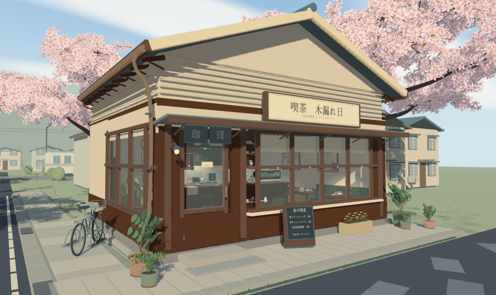
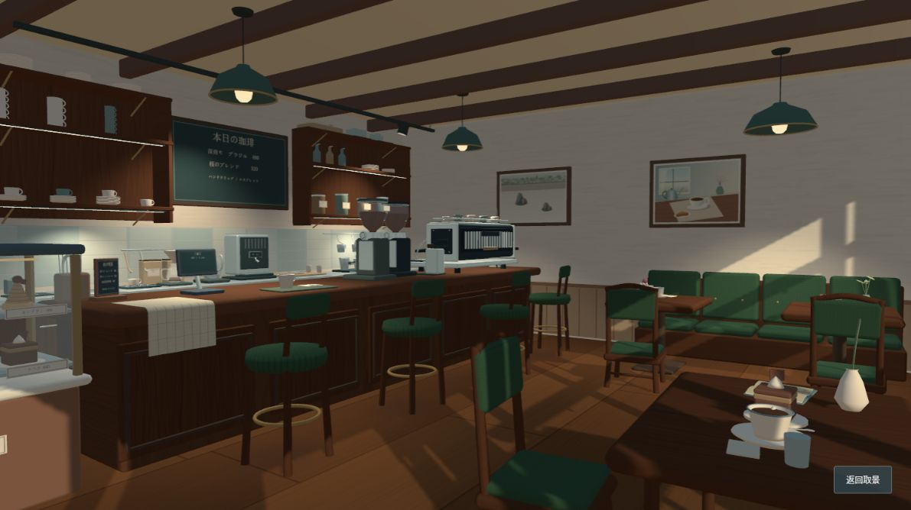

# 木漏れ日 · 樱花街角咖啡馆

## 在线体验

[GitHub Pages · 打开木漏れ日咖啡馆](https://lake-evendim.github.io/komorebi-cafe/)

[原 Sites 入口](https://k-cafe.fresh-salmon-sashimi.chatgpt.site)

GitHub Pages 通过 GitHub Actions 构建并发布 `dist/`，更新 `main` 分支后自动重新部署。

## 最新更新：门口植物与交互界面

- 门口新增水生植物与多肉，搭配虎尾兰、龟背竹、绣球、迷迭香、薰衣草、垂吊绿萝和仙人球；保留入口通道与停车空间。
- 调整睡莲浮叶、花茎及水草的布局，修复草茎穿过浮叶的问题。
- 18 个取景按街角、门前、店内和吧台分组，支持平滑镜头过渡、左右键切换、春风暂停、沉浸模式与照片下载。
- 界面采用暖白与深绿配色，支持窄屏布局；画质与性能信息收纳在偏好设置中。

## 设计理念

「木漏れ日」意为透过树叶洒落的阳光。这间咖啡馆坐落在日本近郊小镇的坡道转角，以春日樱花、木质喫茶店和窗边日光，营造日系青春动画中安静、温暖的日常场景。

建筑以奶油色外墙、深棕木构、青绿雨棚与分片屋瓦构成层次。大面积木框玻璃窗连接街道与室内，暖帘、铜色雨槽、错落绿植、斜置菜单牌和自行车轮槽架，让店面既有生活气息，也保留清晰的入口与行走空间。

室内沿用胡桃木、深绿织物与黄铜的配色，以窗边卡座、阅读桌、墙边书柜和两幅主题画组织不同的停留空间。吧台围绕磨豆、压粉、萃取、备料与交付布置，配备三头商用咖啡机、双磨豆机和六款不同造型的糕点；器物不只是装饰，也表达真实咖啡店的使用顺序。

场景使用 Three.js 程序化建模与自定义着色器，室外采用三渲二阶调明暗，室内保留柔和的连续光照。樱花由实体弯曲花瓣和附着枝梗构成，落瓣从实际花枝出发并检测屋面碰撞；窗光与可见灯具共同塑造空间，而非依靠无出处的补光。

## 场景预览

**咖啡馆主图** — 樱枝、木框窗、入口绿植与自行车停车区。



**店内空间** — 胡桃木吧台、商用咖啡设备、深绿卡座与斜向窗光。



## 来源边界

本仓库为独立咖啡馆街角样片，不是完整樱花车站；周边住宅、铁路与电车用于环境配景。模型与程序纹理由本项目生成，外部依赖和授权说明见 `public/THIRD_PARTY_NOTICES.txt`。

当前版本含 21 个 JavaScript 模块；最新门口植物与界面更新见上文，下文保留第十三轮及之前的历史记录供比较。

## 第十三轮更新

删除右墙收音机、旋钮/格栅/天线及仅承接它的搁板和两根支架，不添加替代摆件。入口封闭伞筒改为三格开放式石墨绿钢架，两把收拢伞分别占侧位，中间留空；底部设置浅接水盘、抽取把手、排水纹和落地脚垫，不再采用垃圾桶式外轮廓。

雨伞架贴 0.348 米地板，X=-1.845..-1.533、Z=1.526..1.974，留在入口窗边。两把伞及伞面与分隔杆的包围范围分开，接水盘承接伞尖。构建、20 模块语法与依赖检查通过；22,000 次落瓣回归、八款菜单和七处实体灯光保留。截图 `output/umbrellas-v13.png`、`output/equipment-v13.png`，数据 `output/validation-v13.json`。

## 第十二轮更新

“本日の珈琲”扩充为八款：深焙巴西、樱花拼配、埃塞俄比亚、低因、浓缩、拿铁、卡布奇诺与冷萃。保留原板尺寸，1320×762 Canvas 纹理分两栏，名称左齐、价格右齐；与货架约 0.09 米净距不变。价格是场景设定。

入口墙角原物件是雨伞筒，旧版仅三根细杆和小弯柄，缺少伞面。这轮补齐收拢伞面褶皱、束带、伞尖与完整弯柄，筒底贴地并保留入口位置。新增“今日咖啡”“入口雨具”两个近景机位方便核对。

构建、20 模块语法/依赖检查、八款唯一菜单与雨具范围断言通过；座位间距、七盏实体灯光和 22,000 次落瓣回归采样通过。截图 `output/coffee-v12.png`、`output/umbrellas-v12.png`，检查 `output/validation-v12.json`。局部细化增加约 2,516 个静态三角形，无新依赖或灯光。

## 第十一轮更新

2026-10-02：毛巾改为沿吧台倒角的连续曲面，垂落褶皱只向台外起伏；卡座、两桌两椅和桌面器皿整体向正面窗户移动 0.82 米，与吧椅包围范围的最小纵向间隔约 0.607 米。书柜后方墙角取消墙体倒角，采用单件 L 形胡桃木收口，消除交界处的细亮线。

磨豆机内不再随机悬置一团豆子，改为从喉口到不规则顶面的连续豆床，表面嵌入实体豆、侧面补贴合豆床的颗粒。收银与托盘交付靠蛋糕柜，磨豆、压粉、敲渣和浓缩机集中在右侧；手冲与温控壶移到后吧台热水备料区，不再沿前台等距陈列。

删除五处无灯具的室内补光。七盏局部光都有可见出处：三盏乳白灯泡吊灯、两盏有轨道/筒身/镜片的工作灯、两处分区搁板下已有灯条。日光和天空保留，局部光仍限制在店内，不增加阴影贴图。

生产构建、20 模块语法和依赖检查通过。临时几何检查覆盖 6,048 个毛巾样本、座位/器械包围范围、208,800 个豆粒顶点、七盏灯的发光实体接触与 220,000 次落瓣采样；这是指定问题检查，不是全场景零交叠认证。最终浏览器检查八个机位，未记录运行错误/警告。截图 `output/*-v11.png`，几何记录 `output/validation-v11.json`，性能 `output/metrics-v11.json`，细节见 `docs/VALIDATION.md`。

## 第十轮更新

2026-10-02：蛋糕柜整组移到吧台左端，包含六款糕点、玻璃、灯条及接触阴影；柜台间留 7 厘米缝隙，左后书柜净距约 0.778 米。门右菜单架绕自身中心斜转 22.5°，保留约 0.914 米踏步净距和地面支撑。

吧台修复蒸汽管穿压力表、冲煮控制与蒸汽旋钮相交、磨豆机出粉嘴压住屏幕、出品菜单侵入磨豆机底座和杯口/出水嘴净距。交付杯、茶匙、菜单和收银屏移到顾客侧；杯碟补堆叠肩/底圈，修正器械和器皿的支撑高度。六款蛋糕、三头商用机、全部花量、MSAA4×及落瓣屋顶碰撞保留。

生产构建、19 模块语法、依赖检查和临时几何断言通过：37 组指定表面交叉检查、6 处支撑射线、220,000 次落瓣位置采样。浏览器检查门前、蛋糕柜、室内、器械和后吧台，最终控制台没有记录运行错误/警告。实拍 `output/*-v10.png`，检查结果 `output/validation-v10.json`，详细边界见 `docs/VALIDATION.md`。

## 第八轮更新

2026-10-02 门前局部修正：菜单立板移到门右侧窗下，离踏步约 0.91 米；删除误放在柏油路上的矮凳、手袋及旁边豆箱，保留入口绿植。最新实拍 `output/entrance-v9.png`，细节验收见 `docs/VALIDATION.md` 第九轮。

- 铺装底层下降、L 形转角不再重叠；保留 0.115 米行走面和自行车轮槽支撑。检查并分离路面补丁、标线及建筑底座的共面面片。
- 蛋糕柜统一四柱结构，侧/前/顶玻璃由薄盒改为独立单面；窗玻璃同样改为单面。17 个真正透明部件分别排序，接触阴影贴花仍合并；蕾丝使用 alpha coverage，不再半透明写叠层。
- 室内点光和聚光只作用于店内坐标范围；纯外景材质、花朵/树叶/落瓣跳过局部灯循环。外墙保留日光与天空，不增加额外阴影贴图。
- 三盏绿釉厚边罩、黄铜卷边、实体灯座与乳白 LED 灯泡；门口五盆高低错落的木本小叶植物/蕨和季节花槽，叶片连接实际枝曲线，入口与轮槽区保持空隙。
- 浓缩机重建为 1.30 米宽三头商用机，双蒸汽臂、三组手柄/分流嘴、双压力表、温杯栏与双大型磨豆机；操作面朝后吧台通道。增加压粉、敲渣、热水塔、沥水/备料/奶缸工位，杯碟与过滤耗材按用途分组。
- 当前 10,821 源部件、350 合并/独立网格、836,068 静态三角形；精细/均衡街角采样约 31.6 / 37.4 FPS。新增细部增加负载，不是受控加速对比；花量与 MSAA 4× 保留。验收记录 `docs/VALIDATION.md`，截图和数据 `output/*-v8.*`。

## 第七轮及以前记录

18 个场景/应用 JavaScript 模块在本目录独立编写，独立确定建筑轮廓、窗洞、屋瓦、器物、树枝和道路构图。没有导入参考目录、上一版 `vendor`、外部模型或图片；木纹、菜单、两幅壁画与近似环境反射图由可编辑 Canvas 画稿生成，花冠由弯曲花瓣几何构成。外部库仅 Three.js 0.186.1、其官方 OrbitControls / BufferGeometryUtils 与构建工具 Vite 8.3.1。

原草稿和 MIT 适配版本仍保留，未用这个样片覆盖它们。设计方向见 `docs/DIRECTION.md`。

## 运行

```powershell
cd D:\Codex\harumachi-original-study
npm ci
npm run build
npm run preview
```

访问 `http://127.0.0.1:5180/`。开发可用 `npm run dev`。需要 WebGL 2、浮点渲染目标与浏览器硬件加速。部署 `dist/` 时保留 Three.js 授权文件。

## 样片范围

- 一间实际窗洞、内部空间、木结构与分片曲面瓦的喫茶店。
- 铜色雨槽、落水管、窗锁、门把手、门灯、暖帘、花盆、黑板、排水格栅与自行车篮/辐条。
- 店内重排为旧喫茶店：胡桃木分区瓷器柜与吧台、瓷砖背板、绿织物吧椅与卡座、窗边双人桌、黄铜脚圈、三盏琥珀/乳白灯罩、镂空蕾丝短帘与伞架。两幅壁画分别为砂纹/石组/苔岛枯山水和窗边咖啡/手冲壶/羊角包静物，使用比例一致的卡纸与双层画框。座椅朝向桌面，保留中间通道；杯碟、糕点和小花瓶按使用情境摆放。
- 保留木梁、开放杯口、收银机、布巾、豆罐、茶罐、杯碟、钟和日历；收音机及专用搁板在第十三轮移除，入口为开放式分隔雨伞架。玻璃蛋糕柜六款不重样：草莓奶油切片、莓果塔、歌剧院蛋糕、巴斯克芝士、抹茶千层、栗子蒙布朗，分别建模并配对应价签，旧重复价签已移除。
- 现代吧台工作区：1.30 米宽石墨黑/不锈钢三头商用咖啡机，温度/压力/分组计时屏、双蒸汽臂、手柄/分流嘴/温杯栏/接水盘；两台称重显示磨豆机，透明仓内连续豆床和嵌入的实体豆；后吧台温控底座细口壶、电子秤/分享壶/滤杯/滤纸，浓缩区奶缸/压粉/敲渣工位。设备是静态艺术模型，屏幕是纹理而非可操作触屏，豆床不是离散颗粒物理模拟。
- 中央矮架及残余顶板移除，改为左后实墙旁 1.94 米高、约 0.39 米深的胡桃木书柜，面对室内、不遮窗洞。四层 43 本闭合书与窗边一本摊开读物；底层大开本、第二层错落堆叠、第三层封面推荐与书挡、顶层小书与陶瓶，搁板高度不再等距。九套书脊/封面纹理共享；柜前到吧台结构净距约 2.07 米，不等同于全空间可行走碰撞验证。
- 前后吧台分开，约 0.925 米操作通道；后柜设开口不锈钢水槽、龙头、沥水盘、抽屉和冷藏面板，左右分区搁板按杯碟、豆罐和糖浆分类，挂轨承接奶缸。中央“本日の珈琲”菜单与搁板水平净距约 0.09 米；前吧台区分手冲/交付和浓缩/压粉，器具底面贴合台面。布局表达工作流程，不是施工规范认证。
- 独立生成的渐细曲枝、细小分叉、五瓣杯状樱花和新叶。花枝连接到骨架采样点，花朵沿细枝布置并由实例花梗连接；飘落出生点直接来自实际花朵变换，风偏移从零开始，轨迹不高于出生点。花冠不使用带透明纹理的大卡片。
- 花瓣碰撞使用建筑实际屋瓦、屋面、雨棚、玻璃和墙体三角形，初始化按空间格预计算每条轨迹首次接触，接触后按表面法线停留、淡出再循环，不再穿屋顶落进室内。静态散瓣也先查询表面，屋顶投影内落在屋面而非室内地板。不是完整刚体模拟，没有滑落、反弹或周边配景建筑碰撞。
- 两位前轮固定架，有轮槽、曲面钢导轨、锚固底板、编号和“お客様専用”牌。前轮进入轮槽、后轮贴合地面；整车倾角与高度同时调整，逐部件变换后与左墙外沿净距约 0.320 米。店牌纹理与实体宽高比完全一致，字体不使用横向压缩。
- 左侧近树移到车道外种植带和方形树池，后树移入店后花园。五树共用位置配置；道路去掉与标线不一致的旋转，车道 X 边界为 -10.8 / -4.2。近树实际树根/低干几何离路约 1.366 米，保守树根净距约 1.304 米。
- 第七轮移除覆盖车道的大块浅色地台和简化凸面镜；店前及侧街改为单片连续柏油面，颗粒纹理按世界尺寸重复。浅色铺装限定为店边 L 形步道，路缘与排水沟终止于转角，停车架和自行车承接地面高度不变。
- 周边住宅、树木、电柱、铁路和静态远景电车；没有运行时刻、人物或完整漫游物理。

十六个机位：街角全景、店面近看、喫茶店内、屋檐与樱枝、轮槽停车架、卡座与窗光、吧台器具、豆仓与压粉、两幅壁画、墙边书柜、六款蛋糕、后吧台工作区、今日咖啡、入口雨具、路缘与树池、背面外墙。拖动环顾、滚轮靠近。纯画面隐藏操作界面，Esc 返回；保存 PNG 打开无界面三维画面的预览与下载链接。

## 渲染与负载

两档都保留 MSAA 4× 和全部器物、全部花朵数量，不靠删除树木来提高帧率。精细：DPR 上限 1.5、4096 阴影；均衡：DPR 上限 1、2048 阴影。花朵按实际像素投影分三级几何，初始边界为 14/32 像素；近处保留弯曲缺口花瓣与花蕊，中距保留缺口/杯形，远处使用简化杯形花瓣。加入 12–16 / 28–36 像素滞回，减少边界反复切换；不同档位和镜头切换路径的花冠面数会不同。第四轮改为沿附着细枝排花，未增加花量；新叶也放回细枝上。静态花冠阴影使用固定几何，与镜头分级解耦，花梗与飘落花瓣不投影。

室内按世界坐标边界调整天空漫反射，室内直射使用连续 Lambert 明暗，室外保留三渲二阶调。第十一轮移除旧窗口、工作台与阅读区的无实体补光，改为七处有可见灯具的聚光与实际窗洞的斜向日光。不是实时全局光照或逐灯墙体阴影；不提高全屏曝光，也不增加阴影贴图。樱花材质跳过无关的局部灯循环，室内遮罩每片元只计算一次。

静态细部按材质合并，重复标签共用材质。独立倒角盒保留两段圆弧和光滑法线，平面不做密集细分：每个 92 三角形，之前为 300。当前 9,337 个源细部、307 个合并网格、753,278 个静态三角形、26,220 个四朵花枝实例，共 104,880 朵花。3,420 条附着细枝仅用 8 段/4 边合并；四花梗实例另有 314,640 三角形，与花瓣面数分开统计。43 本闭合书共享九套封面/书脊纹理，避免逐本增加绘制调用。花瓣首次接触使用 34,750 个建筑三角形、96 段路径和五点安全采样预计算，运行帧不做建筑射线检测。花冠按投影分级，不是完整世界分块 LOD。

第六轮 Codex 浏览器桌面街角采样：精细 1488×835 / MSAA 4× / 4096 阴影约 29.7 FPS；均衡 1191×668 / MSAA 4× / 2048 阴影约 35.0 FPS。两档该次均为 331 次绘制、2,921,666 个提交三角形，分级滞回让本次切换没有减少花冠面数。热缓存首构建含碰撞预计算/着色器编译约 1.55 秒，前次冷加载约 3.58 秒。视口、树位与镜头路径不同，不能作为相对第五轮的受控加速结论；新增陈列/灯光的成本仍存在。完整记录见 `docs/VALIDATION.md` 与 `output/metrics-v6.json`，历史记录保留。

## 验收与未完成项

已运行生产构建、18 个 JavaScript 语法检查与依赖检查。第六轮临时 Node 断言比较 432 次碰撞查询与 Three.js Raycaster、22 万次飘落位置无室内点或超高、1,400 片静态花瓣无屋面下方点；五树低干/树根实际几何离开车道、四层书籍组合各异、菜单不碰搁板、前后柜通道和水槽开口/设备底面通过。树位改变后重新生成发射点，有 11 条轨迹落在屋面、92 片静态散瓣在屋顶。Canvas 绘画在 Node 中使用桩对象，实际纹理与着色器另在浏览器近景检查。暂停后 FPS 0，390×844 文档宽/滚动宽均为 390，最后一个树池机位可选；新图见 `output/*-v6.jpg`。没有项目测试框架，未引入框架。

这仍是独立街角样片：周边住宅与电车只是配景，花冠大轮廓仍有分簇感；玻璃使用程序生成的近似反射，不是真实场景反射/折射；没有实现室内全局光照。局部质量提升不等于已达到参考的整体美术成熟度。

构建入口约 699.63 kB（gzip 188.14 kB），500 kB 体积警告仍存在。第七轮最终浏览器控制台没有记录运行错误/警告；第五轮的 ANGLE X4122 微小浮点精度警告保留在历史验收记录中。

